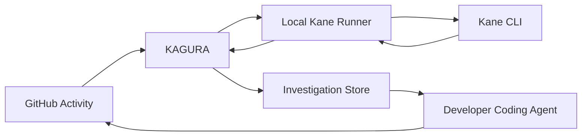

# KAGURA

KAGURA is a developer verification and investigation platform built around GitHub activity and Kane CLI.

Its purpose is to help developers identify, understand, investigate, and resolve genuine application issues discovered during verification.

KAGURA does not replace a developer's coding agent. It does not treat every commit as a bug. GitHub activity alone is not proof of an application defect. Kane CLI is the external verification tool KAGURA integrates with. KAGURA processes verification outcomes and manages the resulting investigations. Developers remain in control of code changes using their preferred coding agent.

## Table of Contents

- [Overview](#overview)
- [Core Idea](#core-idea)
- [Product Workflow](#product-workflow)
- [Investigation System](#investigation-system)
- [Architecture](#architecture)
- [API Surface](#api-surface)
- [Installation and Local Development](#installation-and-local-development)
- [Environment Variables](#environment-variables)
- [Implementation Status](#implementation-status)
- [Future Direction](#future-direction)
- [Validation](#validation)

## Overview

KAGURA helps developers turn real verification evidence into structured, actionable investigations.

The central idea is:

**GitHub activity provides the trigger and context. Kane CLI provides verification evidence. KAGURA turns actionable failures into structured investigations that developers can understand and resolve.**

## Product Workflow

1. A developer signs in and connects GitHub.
2. The developer selects or connects a repository/project.
3. KAGURA observes relevant repository activity.
4. Relevant changes can trigger a Kane CLI verification job.
5. The runner claims and executes the verification job.
6. Kane CLI verifies application behaviour and produces results/evidence.
7. KAGURA processes the verification outcome.
8. Only genuine, actionable failures supported by evidence should become investigations.
9. KAGURA provides a technical explanation, a plain-language explanation, and an issue-specific fix prompt.
10. The developer uses their preferred AI coding agent to implement the fix.
11. Subsequent repository activity can trigger another verification.
12. KAGURA uses subsequent verification evidence to update or resolve the investigation when appropriate.



## Investigation System

An investigation represents a genuine, actionable application issue supported by verification evidence.

Verification results become investigations only when the outcome is actionable. Repeated findings are matched and updated rather than duplicated. Investigation records are linked to verification records. Technical explanations and plain-language explanations are generated from evidence. Fix prompts are produced for external AI coding agents. Subsequent successful verification can resolve an investigation when matching evidence supports it. Duplicate processing is handled. Failed processing can be retried. Stale processing is recovered.

Processing lifecycle:

`pending → processing → processed`

There is also a `failed` processing state with retry and recovery behaviour.

Investigation processing state is distinct from the actual status of an investigation.

### Verification rules

- A failed verification must have meaningful evidence before it becomes an actionable investigation.
- Blocked jobs are not automatically application bugs.
- Jobs that never started are not application bugs.
- Infrastructure failures and timeouts without confirmed application failure must not be reported as confirmed application defects.
- Passing verification should only resolve an investigation when the matching evidence supports that conclusion.

Never present infrastructure failures as application defects.

## Architecture

| Component | Responsibility | Relevant files |
|---|---|---|
| Next.js app/dashboard | UI and server rendering | `src/app/(dashboard)` |
| Authentication | GitHub OAuth and session | `src/lib/auth` |
| GitHub integration | Repository discovery/observation | `src/lib/github` |
| Projects | Project CRUD and ownership | `src/app/api/projects` |
| Verification | Kane results and records | `src/lib/verification` |
| Investigations | Processor and store | `src/lib/investigations` |
| Runner | Local Kane execution | `scripts/kane-runner.mjs` |
| AI | Server-side Gemini integration | `src/lib/ai` |
| Stories/editorial | Drafts and publication | `src/lib/stories` |

Components communicate through API routes, shared server modules, and KV/local storage.

## API Surface

Important endpoints:

- `GET /api/investigations` — list investigations.
- `GET /api/investigations/[id]` — get one investigation.
- `POST /api/investigations/reprocess` — retry/reprocess.
- `GET /api/projects` — list projects.
- `POST /api/projects` — create project.
- `GET /api/github/repositories` — discover repositories.
- `POST /api/github/repositories/connect` — connect repository.
- `POST /api/runner/claim` — claim runner job.
- `POST /api/runner/heartbeat` — heartbeat.
- `POST /api/runner/complete` — complete job.
- `POST /api/editorial/publish` — publish draft.

All endpoints require authentication and enforce ownership where applicable.

## Installation and Local Development

Requirements: Node.js 20+, npm, PostgreSQL optional, Kane CLI for verification.

```bash
npm install
cp .env.example .env.local
npm run dev
```

Run typecheck, lint, build:

```bash
npm run typecheck
npm run lint
npm run build
```

Run tests:

```bash
npm run test
npm run test:runner
```

## Environment Variables

See `.env.example`. Key variables:

- `DATABASE_URL` — optional PostgreSQL.
- `GITHUB_TOKEN`, `GITHUB_REPO_OWNER`, `GITHUB_REPO_NAME` — GitHub observation.
- `GITHUB_CLIENT_ID`, `GITHUB_CLIENT_SECRET` — GitHub OAuth.
- `KAGURA_TOKEN_ENCRYPTION_KEY` — token encryption.
- `KAGURA_APP_URL` — app URL for runner.
- `KAGURA_RUNNER_TOKEN` — runner auth.
- `KANE_CLI_USER_AGENT` — Kane user agent.
- `AI_PROVIDER`, `AI_API_KEY`, `AI_MODEL` — optional AI.

Never commit real secrets.

## Implementation Status

Implemented:
- GitHub authentication and repository discovery.
- Project creation and ownership.
- Kane verification pipeline.
- Investigation processing and recovery.
- Verification result display.
- Gemini server-side integration.
- Drafts and report publication.

In progress:
- Full MVP page polish.
- Runner external validation.

Planned:
- Dedicated Investigator UI.
- Investigation overview and detail pages.
- Publication of verified findings.

## Future Direction

KAGURA is intended to become a reliable verification and investigation layer that works alongside developers and their preferred AI coding agents.

## Validation

Validated with `npm run typecheck`, `npm run lint`, `npm run build`, and relevant tests. External blockers: GitHub test account, disposable database, Gemini credentials.

## Preservation

This README documents the current repository without modifying application code.
```
Write -Path README.md -Value $content