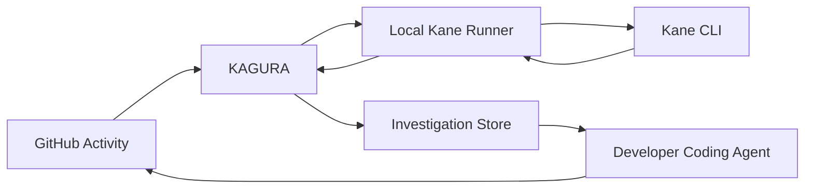
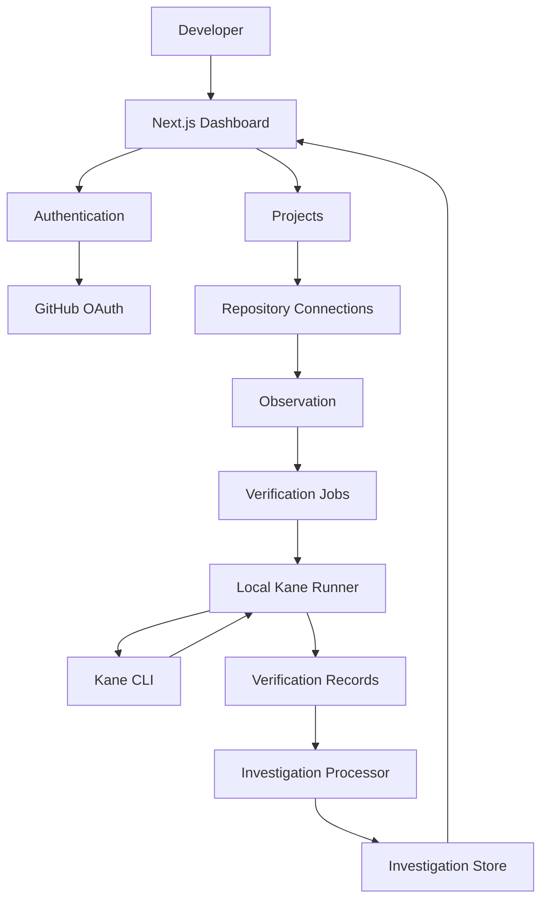

# KAGURA

KAGURA is a developer verification and investigation platform built around GitHub activity and Kane CLI.

Its purpose is to help developers move from repository changes and verification evidence to a clear understanding of genuine application issues and a practical path toward resolving them.

**Observe the changes. Verify actual behaviour. Understand the failure. Guide the fix. Verify again.**

KAGURA does not replace GitHub, Kane CLI, or the developer's preferred coding agent. GitHub provides repository activity and development context. Kane CLI performs application verification. KAGURA coordinates verification and interprets the resulting evidence. Genuine actionable failures become structured investigations. Developers receive technical explanations, plain-language explanations, and issue-specific instructions for their preferred AI coding agents. Developers retain control over how their code is changed. Subsequent verification provides evidence about whether the issue has been resolved.

## Table of Contents

- [Problem](#problem)
- [Who It Is For](#who-it-is-for)
- [Product Workflow](#product-workflow)
- [Investigation Engine](#investigation-engine)
- [Architecture](#architecture)
- [Codebase Structure](#codebase-structure)
- [API Surface](#api-surface)
- [Agent Pipeline](#agent-pipeline)
- [Storage and Data Architecture](#storage-and-data-architecture)
- [Installation and Local Development](#installation-and-local-development)
- [Environment Variables](#environment-variables)
- [Security and Ownership](#security-and-ownership)
- [Implementation Status](#implementation-status)
- [Limitations](#limitations)
- [Future Direction](#future-direction)
- [Validation](#validation)

## Problem

Developers often face a gap between making changes and knowing whether those changes actually work. Verification results alone are frequently insufficient for understanding and acting on a failure. Repository activity, testing, debugging, AI coding agents, and subsequent verification are often disconnected.

KAGURA addresses this by connecting GitHub activity, Kane CLI verification, and structured investigations into a coherent workflow.

## Who It Is For

- Individual software developers
- Developers working with AI coding agents
- Small development teams
- Maintainers of GitHub repositories
- Developers who need better visibility into application verification and issue resolution

## Product Workflow

### Stage 1 — Connect

A developer signs in, connects GitHub, and connects or selects a repository/project.

Relevant files: `src/lib/auth`, `src/app/api/projects`, `src/lib/github`.

### Stage 2 — Observe

KAGURA observes relevant GitHub repository activity.

Repository activity provides context and triggers, not proof of an application defect.

Relevant files: `src/lib/github/observe-project.ts`, `src/lib/github/store.ts`.

### Stage 3 — Verify

Relevant changes can trigger a verification job.

The runner claims and executes the job using Kane CLI.

Relevant files: `scripts/kane-runner.mjs`, `src/app/api/runner`.

### Stage 4 — Investigate

KAGURA evaluates the verification result.

Only genuine actionable failures supported by meaningful evidence become investigations.

Relevant files: `src/lib/investigations/processor.ts`.

### Stage 5 — Understand

An investigation provides:

1. A technical explanation.
2. A plain-language explanation.
3. Relevant verification evidence.
4. An actionable fix prompt tailored to an AI coding agent.

### Stage 6 — Fix

The developer uses their preferred coding agent to implement the suggested fix. KAGURA does not automatically modify source code.

### Stage 7 — Reverify

Subsequent repository activity can trigger another verification. New evidence can update an existing investigation or establish resolution.



## Investigation Engine

An investigation represents a genuine, actionable application issue supported by verification evidence.

- Verification results become investigations only when actionable.
- Repeated findings are matched and updated rather than duplicated.
- Investigation records are linked to verification records.
- Technical and plain-language explanations are generated from evidence.
- Fix prompts are produced for external AI coding agents.
- Subsequent successful verification can resolve an investigation.
- Duplicate processing is handled.
- Failed processing can be retried.
- Stale processing is recovered.

Processing lifecycle:

`pending → processing → processed`

There is also a `failed` processing state with retry and recovery behaviour.

Investigation processing state is distinct from the actual status of an investigation.

### Verification Integrity

- A failed job is not automatically a confirmed application defect.
- A blocked job must not automatically become an investigation.
- A job that never started must not automatically become an investigation.
- Infrastructure errors must not be presented as application failures.
- Timeouts without confirmed application failure must not be treated as proof of a defect.
- Passing verification can resolve an investigation only when the evidence supports that conclusion.

## Architecture



| Component | Responsibility | Important files |
|---|---|---|
| Next.js app/dashboard | UI and server rendering | `src/app/(dashboard)` |
| Authentication | GitHub OAuth and session | `src/lib/auth` |
| GitHub integration | Repository discovery/observation | `src/lib/github` |
| Projects | Project CRUD and ownership | `src/app/api/projects` |
| Verification | Kane results and records | `src/lib/verification` |
| Investigations | Processor and store | `src/lib/investigations` |
| Runner | Local Kane execution | `scripts/kane-runner.mjs` |
| AI | Server-side Gemini integration | `src/lib/ai` |
| Reports | Published report records | `src/lib/stories` |

## Codebase Structure

- `src/app` — Next.js pages and API routes
- `src/lib` — shared server modules
- `scripts` — runner, verification, and tests
- `data` — local runtime data (gitignored)

## API Surface

- `GET /api/investigations` — list investigations
- `GET /api/investigations/[id]` — get one investigation
- `POST /api/investigations/reprocess` — retry/reprocess
- `GET /api/projects` — list projects
- `POST /api/projects` — create project
- `GET /api/github/repositories` — discover repositories
- `POST /api/github/repositories/connect` — connect repository
- `POST /api/runner/claim` — claim runner job
- `POST /api/runner/heartbeat` — heartbeat
- `POST /api/runner/complete` — complete job

All endpoints require authentication and enforce ownership where applicable.

## Agent Pipeline

Existing pipeline stages:

`OBSERVE → ANALYSE → VERIFY → WRITE → REVIEW → PUBLISH`

This is related to, but distinct from, the investigation lifecycle.

## Storage and Data Architecture

- PostgreSQL/KV is used when configured.
- Local filesystem fallback exists for development.
- Investigation records are stored through KV/local storage, not a dedicated investigation database table.
- Atomic distributed locking is not claimed.

## Installation and Local Development

Requirements: Node.js 20+, npm, optional PostgreSQL, Kane CLI for verification.

```bash
npm install
cp .env.example .env.local
npm run dev
```

Run typecheck, lint, build:

```bash
npm run typecheck
npm run lint
npm run build
```

Run tests:

```bash
npm run test
npm run test:runner
```

## Environment Variables

See `.env.example`. Key variables:

- `DATABASE_URL` — optional PostgreSQL
- `GITHUB_TOKEN`, `GITHUB_REPO_OWNER`, `GITHUB_REPO_NAME` — GitHub observation
- `GITHUB_CLIENT_ID`, `GITHUB_CLIENT_SECRET` — GitHub OAuth
- `KAGURA_TOKEN_ENCRYPTION_KEY` — token encryption
- `KAGURA_APP_URL` — app URL for runner
- `KAGURA_RUNNER_TOKEN` — runner auth
- `KANE_CLI_USER_AGENT` — Kane user agent
- `AI_PROVIDER`, `AI_API_KEY`, `AI_MODEL` — optional AI

Never commit real secrets.

## Security and Ownership

- GitHub OAuth and session handling.
- Encrypted token storage.
- Project and repository ownership checks.
- User-scoped access.
- API authentication.
- Runner job claiming and lifecycle.

## Implementation Status

Implemented:
- GitHub authentication and repository discovery
- Project creation and ownership
- Kane verification pipeline
- Investigation processing and recovery
- Verification result display
- Gemini server-side integration
- Drafts and report publication

In progress:
- Full MVP page polish
- Runner external validation

Planned:
- Dedicated Investigator UI
- Investigation overview and detail pages
- Publication of verified findings

## Limitations

- Non-atomic storage operations in some paths
- Processing race windows
- Recovery may require explicit invocation
- Missing route-level tests
- External Kane CLI requirements
- External AI provider dependencies
- Runner configuration and availability

## Future Direction

KAGURA is intended to become a reliable verification and investigation layer that works alongside developers and their preferred AI coding agents.

## Validation

Validated with `npm run typecheck`, `npm run lint`, `npm run build`, and relevant tests. External blockers: GitHub test account, disposable database, Gemini credentials.
```

Write -Path README.md -Value $content